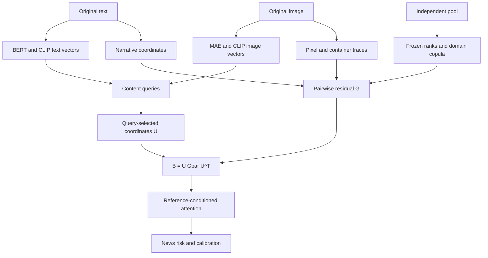

# FlawPrint: Cross-Domain Multimodal Fake News Detection via Copula Residuals of Physical Imperfection Traces

**FlawPrint-CRA** uses trace relations selected by the current news content to condition its multimodal interactions. A frozen domain reference defines the trace-pair matrix; current queries read it through `B = U Gbar U^T`, and shared value vectors carry the resulting content update.

The deterministic FlawPrint baseline achieves **state-of-the-art performance on Weibo, Weibo21, and FineFake**. The content-conditioned CRA results are recorded separately. Experiment settings use a **single NVIDIA GeForce RTX 4090** and seeds **42, 52, 3047, and 3407**.

## Method Chain



1. **Encode content.** Retain the BERT text, MAE image, CLIP text, and CLIP image vectors as four global content nodes.
2. **Measure trace coordinates.** Read noise, frequency, gradient, JPEG, resampling, and container proxies from the original image. Six narrative statistics complete the default 26-coordinate catalogue.
3. **Define a domain reference.** Frozen empirical marginals establish rank coordinates. The copula precision matrix defines pairwise support relative to independent pairing.
4. **Read relations through content.** Each attention head reuses its query/key scores to assign a distribution over available trace anchors. The lifted matrix `U Gbar U^T` supplies distinct content-to-content, content-to-trace, and trace-to-trace interaction conditions.
5. **Learn the news decision.** Residual attention updates the nodes and the news head reads the class node. Source news labels train projections and interactions; separately observed manipulation labels supervise an optional image head.

DRC (Domain-Referenced Coordinates) fixes the statistical comparison scale. PPE (Pair-Preserving Evidence) retains the trace-pair matrix. CET (Content-Conditioned Evidence Transport) maps that matrix through the current queries into attention and value updates. Encoders supply observations, and the unified news head learns their task use.

The [core operation in step 4](engine/neural.py) makes trace relations part of the interaction rule. Each pair of content nodes selects trace coordinates through its current query/key scores; the domain-reference relations between those coordinates condition their attention. Source news labels train how these updates support the final decision.

Pair information contributes through the current query's trace responsibilities. The component lost by diagonal and row summaries has zero row sums: a uniform query cancels its direct contribution, while content-specific responsibilities can turn it into relative attention preferences. The diagnostics below measure retained pair energy, its local use, and the resulting whole-model response separately.

## Project Structure

```text
FlawPrint/
|-- deep.py                  # Embedding extraction, neural training, and prediction.
|-- main.py                  # Trace extraction and deterministic controls.
|-- convert.py               # Dataset conversion.
|-- doctor.py                # Environment inspection.
|-- encode.py                # CLIP similarity control.
|-- research.py              # Paired, composition, and channel analyses.
|-- study.py                 # Propagation, reference, and cost studies.
|-- download.py              # Reference paper downloads.
|-- test.py                  # Regression runner.
|-- engine/embeddings.py     # Frozen local encoder features and cache alignment.
|-- engine/neural.py         # Residual attention and comparison modes.
|-- engine/learning.py       # Group cross-fitting, training, and checkpoint loading.
|-- engine/package.py        # Built-in experiment and dataset settings.
|-- tests/                   # Data conversion, mathematics, and workflow tests.
|-- README.md
```

## Requirements

| Component | Setting |
|---|---|
| Python | >=3.10 |
| NumPy / SciPy | >=1.26, <3 / >=1.11, <2 |
| Pillow / scikit-learn | >=10, <13 / >=1.4, <2 |
| Deep learning | PyTorch >=2.2; Transformers >=4.40, <6 |
| Table input | pandas >=2.2, <4; PyArrow >=15, <30; openpyxl >=3.1, <4; xlrd >=2, <3 |
| GPU | Single NVIDIA GeForce RTX 4090 |
| Seeds | 42, 52, 3047, 3407 |

The server training environment uses Python 3.12.3, PyTorch 2.12.1+cu130, and Transformers 4.57.6. Keep the encoder checkpoints, processors, and preprocessing settings fixed when comparing runs.

Install the [PyTorch build](https://pytorch.org/get-started/locally/) for your CUDA environment, then install the dependencies:

```bash
git clone https://github.com/wlz05/FlawPrint.git
cd FlawPrint
python -m venv .venv
```

```powershell
.venv/Scripts/Activate.ps1
```

```bash
source .venv/bin/activate
```

With the environment active, run the following installation and verification commands in either shell:

```bash
python -m pip install "numpy>=1.26,<3" "scipy>=1.11,<2" "Pillow>=10,<13" "scikit-learn>=1.4,<2" "requests>=2.31,<3" "pypdf>=4,<7"
python -m pip install "torch>=2.2" "transformers>=4.40,<6"
python -m pip install "pandas>=2.2,<4" "openpyxl>=3.1,<4" "pyarrow>=15,<30" "xlrd>=2,<3"
python -B doctor.py --semantic --tables --output ./outputs/environment.json --freeze ./outputs/versions.txt
python -B test.py
```

Use the activation command for your shell. The first installation command supplies the deterministic pipeline, the second adds deep learning, and the third adds Excel and Parquet readers. Trace profiling runs on CPU; deep extraction and training use `cuda:0` by default. Unavailable CUDA devices fail before training with an explicit message; use `--device cpu` for CPU execution.

Parquet input uses the [PyArrow engine](https://pandas.pydata.org/docs/reference/api/pandas.read_parquet.html) explicitly. Run the following check with the same Python interpreter used for conversion and training:

```bash
python -c "import pandas, pyarrow; print('pandas', pandas.__version__, 'pyarrow', pyarrow.__version__)"
python -B -m unittest discover -s tests -p formats.py -k parquet -v
```

For a new machine, create its virtual environment and rerun the installation commands. Reinstall the appropriate CUDA-enabled PyTorch build there. The version list written by `doctor.py --freeze` records the source environment for comparison.

## Datasets

| Dataset | Domains | Train / validation / test files | Partition protocol |
|---|---|---|---|
| [Weibo](https://doi.org/10.1145/3123266.3123454) | 9 | `./data/train_origin.csv`, `./data/val_origin.csv`, `./data/test_origin.csv` | Prepared benchmark partitions |
| [Weibo21](https://github.com/kennqiang/MDFEND-Weibo21) | 9 | `./weibo21/train_datasets.xlsx`, `./weibo21/val_datasets.xlsx`, `./weibo21/test_datasets.xlsx` | Prepared MDFEND-Weibo21 partitions |
| [FineFake](https://github.com/Accuser907/FineFake) | 7 | `./FineFake/train.csv`, `./FineFake/val.csv`, `./FineFake/test.csv` | Label-stratified 60% / 20% / 20%, partition seed 3407 |

Use these existing partition files for every run. Training seeds **42, 52, 3047, and 3407** change model initialization and training order; sample identities and partition membership stay fixed. FineFake's partition seed 3407 is separate from the training seed. The [experiment preset](engine/package.py) records the paths, label conventions, partition policy, and runtime settings.

The released EANN Weibo ID dictionaries contain **5,415 training, 843 validation, and 1,465 test records**. Preserve their membership and event groups when preparing tables; event groups remain grouping variables. FineFake's **16,909 released rows** produce **10,145 training, 3,382 validation, and 3,382 test records** under the fixed paper partition. Keep each released row's ordinal before creating these files. The `finefake-paper-3407` contract records `id = finefake:<source_ordinal>`, `group = id`, and the existing partition role; canonical conversion retains this metadata.

Weibo and Weibo21 annotations use **0 = real, 1 = fake**. FineFake annotations use **0 = fake, 1 = real**; conversion maps them to the common FlawPrint convention **0 = real, 1 = fake**. The seven FineFake domain slots include `Uncategorized`.

## Prepare Data

Run commands from the repository root. All image, model, and output paths are relative to that directory. Canonical labels are **0 = real, 1 = fake**.

```json
{"id":"news001","image":"./data/images/news001.jpg","text":"Example news text.","domain":"Politics","group":"event001","split":"test","label":1}
```

| Field | Meaning |
|---|---|
| `id` | Unique stable string shared by all feature caches |
| `image` / `text` | Relative image path or empty string; original news text |
| `domain` / `group` | Domain and event or duplicate-group identity |
| `split` | Standard `train`, `validation`, or `test`; optional `calibration` and `profile` |
| `label` | News-veracity label; absent from target profile rows |
| `physical_manipulated` | Optional independently observed Boolean image attribute |
| `content_sha256` | Image-byte fingerprint populated by extraction |
| `image_frame` | Explicit `0` to use the first frame of an animated or multipage image |
| `physical_trace_disabled` | Boolean disabling image trace coordinates while retaining the image for deep encoding |
| `benchmark_protocol` / `source_ordinal` | FineFake paper partition contract and immutable released row ordinal |

Blank optional cells are treated as absent in CSV, TSV, Excel, and Parquet. Frame selectors and FineFake source ordinals retain integer values after conversion; Boolean selectors, fractional values, and out-of-range ordinals are rejected. The same metadata survives JSON and table round trips without changing sample IDs or partition roles.

Dataset presets retain the declared frame, trace-availability, and FineFake partition fields automatically. Use `--keep-column` for additional custom metadata. Conversion validates the retained fields before publishing the manifest and keeps the preset's label direction.

Do not infer `physical_manipulated` from news labels. Missing attributes remain unknown. The `schema`, `conversion`, and `labels` presets in [engine/package.py](engine/package.py) define the row contract and conversion rules.

```bash
python -B convert.py ./data/train_origin.csv --dataset WEIBO --mapping builtin:weibo --split train --output ./data/weibo_train.jsonl
python -B convert.py ./weibo21/train_datasets.xlsx --dataset Weibo21 --mapping builtin:weibo21 --split train --output ./weibo21/train.jsonl
python -B convert.py ./FineFake/train.csv --dataset FineFake --mapping builtin:finefake --split train --output ./FineFake/train.jsonl
```

Convert each existing file with its matching `--split`. Dataset selection normalizes names to lowercase. JSONL, NDJSON, JSON, CSV, TSV, Excel, and Parquet are supported. The complete Weibo conversion and cache workflow is:

```bash
python -B convert.py ./data/val_origin.csv --dataset weibo --mapping builtin:weibo --split validation --output ./data/weibo_validation.jsonl
python -B convert.py ./data/test_origin.csv --dataset weibo --mapping builtin:weibo --split test --output ./data/weibo_test.jsonl
python -B convert.py ./data/weibo_train.jsonl ./data/weibo_validation.jsonl ./data/weibo_test.jsonl --dataset canonical --output ./data/manifest.jsonl
python -B main.py validate ./data/manifest.jsonl --benchmark --check-images --output ./outputs/preflight.json
python -B main.py extract ./data/manifest.jsonl --workers 1 --output ./data/features.npz
```

Use the corresponding files from the dataset table for Weibo21 and FineFake. Conversion and merging retain sample IDs and the supplied partition roles. Frozen deep encoders and deterministic trace extraction produce reusable caches for those same records. Source training groups supply the domain reference through cross-fitting. Separately supplied target-reference records use the optional `profile` role.

CSV input defaults to UTF-8-SIG; select `--encoding gb18030` for a file saved in that encoding. When annotations contain image filenames, set `--image-root ./data/images`. Custom tables can select columns explicitly, for example `--text-column content --image-column image_path --domain-column category`. Use `python -B convert.py --help` for the complete mapping options.

Configuration defaults are built in. Use `--config builtin:default` for standard profiling, `--config builtin:quick` for the synthetic check, and `--config builtin:seed42` for the corresponding experiment seed. Neural training defaults to `builtin:neural`. Dataset conversion selects `builtin:weibo`, `builtin:weibo21`, or `builtin:finefake` through `--mapping`; the mappings declare the released label direction explicitly. A custom relative JSON path remains supported for each configuration option.

## Pretrained Encoders

Place complete Hugging Face checkpoints, tokenizer assets, and processor files in `./models/bert`, `./models/mae`, and `./models/clip`. Extraction reads local files only through Transformers' [offline loading](https://huggingface.co/docs/transformers/installation#offline-mode). For Chinese input, compatible checkpoint families include [Chinese RoBERTa-wwm-ext](https://huggingface.co/hfl/chinese-roberta-wwm-ext), [ViT-MAE-base](https://huggingface.co/facebook/vit-mae-base), and [Chinese-CLIP](https://huggingface.co/OFA-Sys/chinese-clip-vit-base-patch16). Use language-matched BERT and CLIP checkpoints for other languages, and keep their exact files fixed within a comparison.

Each directory contains `config.json` and its weights, including every shard when an index file is present. BERT also needs its tokenizer assets; MAE needs its image processor; CLIP needs both its tokenizer and image processor. Copy the actual files into these local directories. Encoder extraction requires the original images, while cached training and prediction use the prepared NPZ archives.

Chinese-CLIP text features use the projected class token. When an image has several frames, set `image_frame` explicitly in the manifest; extraction uses the same selected frame for physical and deep features. For images that cannot support the physical tile grid, set `physical_trace_disabled` to `true`. Their image content remains available to MAE and CLIP, and their image trace coordinates are masked.

`deep.py` retains the BERT and MAE class-token vectors and both projected CLIP vectors. MAE uses all patches in fixed order. BERT and CLIP text are truncated to the smaller of the requested length, tokenizer limit, and checkpoint context. The archive records the requested and effective lengths, vector readouts, encoder hashes, availability masks, identities, and image checksums. Cache replacement is atomic; failed writes preserve an existing archive.

```bash
python -B deep.py extract ./data/manifest.jsonl --bert ./models/bert --mae ./models/mae --clip ./models/clip --batch-size 64 --max-length 128 --device cuda:0 --output ./data/deep.npz
```

Extraction also supports the following controls:

| Option | Default | Alternative |
|---|---|---|
| `--text-processing` | `identity`: retain the original text | `eann`: released EANN cleaning, followed by lowercase conversion |
| `--pooling` | `cls`: BERT and MAE class tokens | `summary`: concatenate class, observed-word or patch mean, and maximum vectors |
| `--image-processing` | `model`: checkpoint MAE processor | `ddin`: bilinear resize of the short side to 256, center crop to 224, and ImageNet normalization |

A local text checkpoint containing both `pooler.json` and `pooler.pt` restores its trained class-token and CNN readout automatically. The cache records the actual readout, preprocessing definition, and encoder identity. Training and prediction require matching feature protocols; regenerate caches together when changing these settings.

Pooler loading checks the configuration and every parameter on CPU before moving the model to the selected device. Duplicate configuration keys, unsupported dimensions, missing tensors, incompatible shapes or dtypes, and nonfinite weights produce an explicit error. UTF-8 files with a byte-order mark are supported.

Selected models and text poolers restore float32 parameters on CPU before transfer to the requested device. Loading is independent of process-wide default dtype and device settings and preserves the caller's random state.

Add `--forensic ./models/forensic` for a separately trained, Hugging Face-compatible forensic CLIP image encoder. This interface reads pooled image features. Every compared mode uses the same encoder set and cached sample identities. Image edits, JPEG compression, or resizing are followed by extraction of both physical and deep features.

Physical and deep caches must agree on selected frames and the declared benchmark contract as well as sample IDs, content metadata, and image fingerprints. Cache alignment accepts equivalent relative slash styles and split aliases, validates physical row uniqueness before reindexing, and leaves both input archives unchanged.

Training and prediction use the same canonical metadata for sample selection and saved references. For example, `val` selects the supplied validation rows and `--split testing` selects the supplied test rows. These spelling conversions preserve sample membership and order.

## Train and Predict

The [training pipeline](engine/learning.py) consumes the cached records with their supplied `train`, `validation`, and `test` roles. Encoders remain frozen. Each epoch shuffles training indices with the run seed and samples mini-batches of 64 records; a final smaller batch is retained. Training records fit the feature standardizers and source references, and train the projections, residual attention, and news head. After each epoch, validation Macro-F1 selects the checkpoint and controls early stopping with patience 5. The selected checkpoint is then used for the final test run.

Validation ties retain the first best epoch. `selected_epoch` records that epoch in `model.json` and the training summary; saved parameters come from this selected state.

Each epoch prints training loss and validation Macro-F1, Accuracy, and AUC. The optional settings below belong in the relative JSON supplied through `--config`; omitted settings retain the built-in defaults.

| Setting | Default | Operation |
|---|---|---|
| `trace_dropout` | `0.0` | Mask a sample's trace channel during training with the specified probability |
| `label_smoothing` | `0.0` | Smooth source training targets |
| `aligned` | `false` | Preserve CLIP cosine similarity before separate stream normalization |
| `paired` | `false` | Preserve CLIP coordinate products, absolute differences, and cosine similarity in a pair node |
| `balanced_reference` | `false` | Preserve source class proportions while assigning intact groups to reference folds |
| `content_query` | `false` | Initialize the classification query from available content nodes |
| `field_only` | `false` | Use fixed trace anchors to condition attention over content values |
| `unit_coordinates` | `false` | Normalize anchor-reading vectors by their Euclidean norm |

These controls are saved with the selected model and restored during prediction. They do not change the formal train, validation, or test membership. The standard CRA configuration keeps them disabled.

Use `--state` to save an atomic checkpoint after each complete epoch. The state contains current and selected weights, optimizer moments, validation history, early-stopping counters, and Python, NumPy, PyTorch, and CUDA random states. Add `--resume` to the same command after interruption. A partially completed epoch is rerun from the last saved boundary. Resumption requires matching caches, configuration, source code, and numerical runtime settings; it preserves validation-based model selection.

Resumption aligns deep-cache vectors by sample ID before checking their identity. Equivalent relative slash styles, split aliases, and deep-cache row order can differ after transfer. LF and CRLF source files share the same implementation identity, while code changes produce a different fingerprint. Physical row order, feature values, sample identities, partition membership, and encoder preprocessing remain fixed.

Keep the `.pt` or `.pth` state file outside the selected model directory. A fresh run requires a new state file; resumption reads the existing file. Move the state, repository, caches, and configurations together when changing machines. Prediction uses the published model directory independently of the training-state file. Without `--state`, an interrupted run restarts at epoch 1. The complete selected checkpoint is published as one directory; a failed final rename restores a pre-existing empty destination.

```bash
python -B deep.py train ./data/features.npz ./data/deep.npz --dataset weibo --seed 42 --device cuda:0 --state ./outputs/resumable42/progress.pt --output ./models/resumable42
```

After an interruption, resume the saved run with:

```bash
python -B deep.py train ./data/features.npz ./data/deep.npz --dataset weibo --seed 42 --device cuda:0 --state ./outputs/resumable42/progress.pt --resume --output ./models/resumable42
```

For the standard run without an epoch-state file:

```bash
python -B deep.py train ./data/features.npz ./data/deep.npz --dataset weibo --config builtin:neural --profile-config builtin:default --seed 42 --mode coupled --device cuda:0 --output ./models/neural42
python -B deep.py predict ./data/features.npz ./data/deep.npz --model ./models/neural42 --split test --device cuda:0 --output ./outputs/neural42/predictions.jsonl
```

Run the complete **42, 52, 3047, 3407** experiment automatically:

```bash
python -B deep.py experiment ./data/features.npz ./data/deep.npz --dataset weibo --seeds 42 52 3047 3407 --mode coupled --device cuda:0 --output ./outputs/experiment
```

`experiment` defaults to these four seeds and runs each seed's training and selected-checkpoint test separately. `--dry-run` prints the commands. Each `seed<seed>/` directory contains the model, test predictions, the metric report, and `result.json`. `summary.json` stores individual seed metrics in `byseed` and metric means and sample standard deviations in `metrics`. The final mean is `(score42 + score52 + score3047 + score3407) / 4`; sample standard deviation uses denominator three. Metrics are calculated separately for each seed before averaging, with equal seed weights. Missing seeds or different input hashes or test identities prevent aggregation. A metric undefined for any seed retains an undefined overall mean. Use a fresh experiment directory for each dataset and model mode.

The experiment fixes the Python source fingerprint before the first seed and checks it around every training and prediction run. Each selected checkpoint must carry that same fingerprint. Editing the implementation during the experiment stops the run before publishing a mixed-version average; completed seed records retain their original implementation identity.

The single-run `train --seed` and `predict` commands remain available. Run the other experiment seeds with separate model directories:

```bash
python -B deep.py train ./data/features.npz ./data/deep.npz --dataset weibo --seed 52 --mode coupled --output ./models/neural52
python -B deep.py train ./data/features.npz ./data/deep.npz --dataset weibo --seed 3047 --mode coupled --output ./models/neural3047
python -B deep.py train ./data/features.npz ./data/deep.npz --dataset weibo --seed 3407 --mode coupled --output ./models/neural3407
```

Use `--dataset weibo21` or `--dataset finefake` with that dataset's prepared caches for the other benchmarks. Predict each selected checkpoint on the same test identities and report mean and sample standard deviation across the four seeds. The model directory stores `parameters.pt`, `model.json`, `profiles/`, and CLI `provenance.json`. Metadata records the run seed, settings, partition counts, encoder protocol, and input hashes. Labeled test predictions produce a `.report.json` metric file. The standard three-partition workflow outputs the news-head decision and sigmoid probability. An additional supplied `calibration` partition enables probability calibration and prediction sets as a separate evaluation option.

To move an experiment, copy the source, both feature archives, and the complete trained model directory, including `model.json`, `parameters.pt`, and `profiles/`. Keep image paths and the dataset layout relative to the repository root, then run commands from the copied root with the new relative model and cache paths. Prediction reads the cached vectors and saved references without loading the pretrained encoders or the original training input files. Copy complete encoder files when extracting features on the new machine; links into another machine's model cache are not portable. Both slash styles are accepted for relative CLI paths. Use `--device cpu` for a CPU run or `--device cuda:0` for the experiment GPU.

The cache archives and complete model directory may move to new relative locations or names; pass those locations through the two positional cache arguments and `--model`. Preserve sample IDs, image paths within both archives, and files inside the model directory. Image paths are resolved from the repository root during extraction; cached prediction uses their recorded identities. GPU runs require a CUDA-enabled PyTorch installation even when all features are already cached.

Physical and deep archives must agree on recorded image checksums. When either archive records a checksum, the other contains the same one. Re-extract both caches from the same manifest when a pair is incomplete.

Reloading verifies `model.json`, `parameters.pt`, and every saved reference file before inference. Checkpoint paths resolve within the copied model directory, and reference domains match their metadata keys. File checksums cover the exact bytes decoded into metadata, references, and tensors; the complete file set is checked again before predictions are returned. Each prediction records `checkpoint_sha256`, the SHA256 of `model.json`, which remains stable when the complete model directory moves.

### Reference and Calibration Roles

For each domain, the reference comes from its source-training rows or an independently supplied `profile` pool. Source-training queries use references fitted on other connected event, image, and content groups; validation and saved source references use the complete source-training rows. Reference subsets below the configured `min_samples` use the content path for that query group. An independently evaluated target domain supplies its own unlabeled profile rows, which are merged into the manifest before both caches are extracted. The standard three-partition workflow is complete with `train`, `validation`, and `test`.

For a target domain without source-training rows, convert its reference table with the `profile` role. Dataset-specific profile tables require text and domain columns; label columns are optional. Existing annotations are discarded before label mapping.

```bash
python -B convert.py ./data/reference.csv --mapping builtin:weibo21 --split profile --output ./data/reference.jsonl
```

Merge these rows with the prepared partitions before extracting both feature archives. Conversion rechecks every source table after reading the complete batch.

An additional independently supplied `calibration` partition enables probability fitting on validation predictions and prediction-set calibration on those extra rows. For frozen-source transfer, add `--reference-domain Politics` to a prediction command to select a saved source reference named `Politics`. Select a key listed in `model.json` under `profiles`. Use a fresh output directory for each seed and mode; the directory contains the complete checkpoint needed by prediction.

## Baselines and Ablations

| Core mode | Relation access | Readout |
|---|---|---|
| `deep` | No trace input | Ordinary content attention |
| `unbiased` | Ranks, diagonal entries, and row summaries | Ordinary attention over summary tokens |
| `summary` | The same nodes; relation reconstructed from its diagonal and row sums | Current-query responsibilities over the reconstructed relation |
| `uniform` | The same tokens and the complete relation matrix | Uniform responsibilities in the reference map |
| `coupled` | Identical to uniform | Current-query responsibilities in the reference map |

Two matched comparisons isolate the core operation. `summary` versus `coupled` keeps the node summaries, current-query rule, and trainable parameter count while replacing the full relation with its minimum-norm reconstruction from the same diagonal and row sums. `uniform` versus `coupled` keeps the complete relation and ordinary content attention while changing only responsibilities in the reference map. The `unbiased` comparison additionally removes the potential.

Train the two controls from the same caches and repeat each with seeds 42, 52, 3047, and 3407:

```bash
python -B deep.py train ./data/features.npz ./data/deep.npz --dataset weibo --seed 42 --mode summary --device cuda:0 --output ./models/summary42
python -B deep.py train ./data/features.npz ./data/deep.npz --dataset weibo --seed 42 --mode uniform --device cuda:0 --output ./models/uniform42
```

Additional controls are `independent` (ranks only), `concat` (MLP over summary tokens), `broadcast` (the earlier row-summary operator), `diagonal` (diagonal-only potential), and `shuffled` (permuted relation identities). Use a fresh model directory for each mode and retain the same encoder caches, source supervision, split identities, and training budget. Keep auxiliary image supervision identical and report actual parameter counts.

The evaluation separates the reference source, retained pair information, and content-query responsibility. [MLCCD](https://arxiv.org/abs/2610.36569v1) studies task-conditioned semantic evidence selection, [SSPC](https://aclanthology.org/2026.emnlp-main.1279/) separates relation reliability from prediction reliance, and [MMFact](https://arxiv.org/abs/2610.34162v1) organizes compatible shared inputs. These studies inform the comparison design; the repository retains its existing dataset partitions.

Related complete news models include [DAPT](https://doi.org/10.1145/3746027.3755192), [DAMMFND](https://github.com/luweihai/DAMMFND), [MMDFND](https://github.com/yutchina/MMDFND), and [TERN](https://www.mdpi.com/2076-3417/16/13/6759). [ReAlign](https://openaccess.thecvf.com/content/CVPR2026/papers/Huang_ReAlign_Generalizable_Image_Forgery_Detection_via_Reasoning-Aligned_Representation_CVPR_2026_paper.pdf) provides a learned image-forensics comparison. [Falsdo](https://www.ijcai.org/proceedings/2026/275) motivates artifact-matched Real/Control/Fake evaluation.

### Fixed-Checkpoint Intervention

```bash
python -B deep.py predict ./data/features.npz ./data/deep.npz --model ./models/neural42 --split test --device cuda:0 --explain --output ./outputs/neural42/intervention.jsonl
```

`--explain` records how the saved model uses its reference while keeping the original prediction and calibration:

| Field | Measurement |
|---|---|
| `attention_contrast_rms` | Mean layer RMS of the scaled potential after removing each row's shared offset |
| `attention_shift_tv` | Mean layer total variation between attention with and without the potential, using the same layer inputs |
| `pair_relation_fraction` | Fraction of relation energy outside its diagonal-and-row-sum reconstruction, for coupled checkpoints |
| `pair_contrast_rms` | Mean layer RMS of the effective pair-only bias on available class and content queries |
| `pair_attention_shift_tv` | Mean layer attention total variation after removing only unsummarized pair information at the same layer state |
| `value_transport_rms` | Layer-mean RMS of the projected content-query update versus the same layer without the reference potential |
| `pair_value_transport_rms` | Layer-mean RMS of the projected content-query update after removing only unsummarized pair relations |
| `pair_tangent_transport_rms` | Layer-mean RMS of the projected value-logit covariance at the summary attention state |
| `pair_transport_remainder_bound` | Upper bound on the layer-mean RMS error of that first-order update at the full pair-bias strength |
| `potential_disabled_risk` / `potential_risk_delta` | Whole-model raw risk with the potential disabled / original minus disabled risk |
| `uniform_readout_risk` / `query_readout_delta` | Whole-model risk with uniform content responsibilities / original minus uniform risk |
| `summary_readout_risk` / `pair_readout_delta` | Whole-model risk with summary-reconstructed relations / original minus summary risk |

Local measurements include the class node and available content queries, with all available keys; masked nodes are excluded from their denominators. A missing relation gives zero local change. The concat control has no attention measurements and exports missing values. Coupled checkpoints add three diagnostic forwards: potential off, uniform responsibility, and summary reconstruction. Uniform and summary checkpoints report zero for their corresponding self-intervention delta; other inapplicable readouts export missing values. Input nodes and weights stay fixed while hidden states update normally in each forward pass. Probabilities and prediction sets use the original model risk.

Pair diagnostics are available for coupled checkpoints. Local summary removal reuses the current Q/K/V tensors and masks; it does not launch another whole-model forward. Other modes export missing values for these fields. Compare these measurements by news ID with `pair_readout_delta` and the paired task outcomes: retained matrix energy, local attention use, and final correction measure different stages of the same readout.

For a fixed query and head, let `p` be summary attention, `delta` the full-minus-summary logit change, `S = Cov_p(V, delta)`, `D` the value diameter, and `L` the logit-change range. At any finite strength `t`, the update is `t S + R(t)`, with `norm(R(t)) <= t^2 D L^2 / 8`. This bound covers distinct continuous logits. A zero tangent can leave a nonzero second-order response; the reported remainder bound quantifies the finite error. Each head's bound is multiplied by its output-projection Frobenius norm, summed across heads, and aggregated using the same query and output-width denominator as the measured update. The model's scaled pair bias is included in `delta`, so the exported bound uses `t = 1`. Diagnostics leave predictions unchanged and keep the shared value offset out of the calculation. [GOAT](https://arxiv.org/html/2601.15380v2) provides related attention-prior and value-sensitivity analysis; this diagnostic changes pair logits while holding values fixed.

Equal-potential groups provide a separate exact control: transport is zero at every strength precisely when all groups have the same baseline-weighted value mean. With all potential changes distinct, this requires equal values. Structured neutralization tests and continuous near-orthogonality tests cover these two settings separately.

The saved reference defines trace compatibility; the trained news head determines its task use. To evaluate reference composition, retain the same weights and test IDs, rebuild independent pools at matched sizes, and report the complete-model predictions alongside local transport. `--reference-domain` selects a reference already saved with the checkpoint; its files and hashes remain bound to that model. Source-reference transfer and independent target-pool evaluation are separate settings. Composition labels serve only offline pool construction and evaluation. Confidence filtering is a separate reference-admission control, with retention and within-class selection changes reported together. [LSA](https://arxiv.org/html/2606.15169v1) and [JMLR label-shift inference](https://www.jmlr.org/papers/v27/25-2717.html) study prior adjustment under specified distribution assumptions; reference replacement here also changes the network's trace inputs.

Prediction files support JSONL, NDJSON, JSON, CSV, and TSV. The shared [prediction reader](engine/results.py) restores numeric diagnostics and missing values consistently across these formats, including summary risks and all pair measurements. Frame indices and FineFake source ordinals reload as integers, and physical-channel availability flags reload as Booleans.

Missing or null labels use the unlabeled prediction flow. Use a fresh prediction output path for unlabeled queries when a report already exists at the corresponding `.report.json` path. The command checks this before writing, preserving the existing predictions and report.

Conversion, physical extraction, and neural prediction prepare their data and report files together before publication. A report-write failure leaves existing outputs intact; a failed replacement rolls back files already replaced. If rollback cannot restore a file, the error identifies the retained recovery copy.

New checkpoints use `flawprint-neural-v2` and record the relation operator. Existing `v1` coupled checkpoints retain their original broadcast operation when loaded. Prediction output includes the effective mode and checkpoint version.

## Implementation Details

| Setting | Value |
|---|---|
| GPU / seeds | Single RTX 4090 / 42, 52, 3047, 3407 |
| Maximum epochs / batch size | 50 / 64 |
| Optimizer / learning rate / weight decay | [AdamW](https://docs.pytorch.org/docs/stable/generated/torch.optim.AdamW.html) / 0.0001 / 0.01 |
| Learning-rate schedule | Constant |
| Source selection / patience | Validation macro F1 / 5 epochs |
| Maximum text length | 128, limited by each encoder's context |
| Projected width / heads / layers | 128 / 4 / 2 |
| Dropout / gradient norm limit | 0.1 / 1.0 |
| Residual-potential bound | 2.0 |
| Source-reference group folds | 2 |
| Optional image-loss weight | 0.1 |
| Trace image longest / minimum side | 768 / 32 pixels |
| Trace schema / local grid | 20 image + 6 narrative / 4 x 4 |
| Global / local shrinkage | 0.1 / 0.35 |
| Minimum reference samples | 20 |
| Deterministic sign bootstrap | 100 repetitions |

The inverse correlation is estimated only in retained trace coordinates. The neural path uses the global pairwise matrix; local sign penalties belong to the deterministic control. Missing streams are masked. Missing or insufficient references produce zero relation potential and preserve deep inference.

Report Accuracy and classwise Precision, Recall, and F1 alongside macro F1 and ROC-AUC, as used in [DAMMFND](https://ojs.aaai.org/index.php/AAAI/article/view/32036) and [MMDFND](https://github.com/yutchina/MMDFND). Classification metrics use the [scikit-learn evaluation API](https://scikit-learn.org/stable/modules/model_evaluation.html), with reporting implemented in [engine/metrics.py](engine/metrics.py). Report source-calibrated probability metrics and prediction-set coverage separately. Image-authenticity auxiliary metrics use independent image labels.

## Deterministic Controls

The original trace/copula scoring and external semantic fusion remain available. Verify the core pipeline with a synthetic fixture:

```bash
python -B main.py fixture --seed 42 --per-split 24 --output ./data/fixture.npz
python -B main.py benchmark ./data/fixture.npz --config builtin:quick --seeds 42 --bootstrap 25 --ablations --output ./outputs/smoke
```

Provide frozen news logits increasing toward fake news, join by exact identity, and benchmark:

```json
{"id":"news001","logit":1.25}
```

```bash
python -B main.py join ./data/manifest.jsonl ./data/semantic.jsonl --score-key logit --output ./data/semantic_manifest.jsonl
python -B main.py extract ./data/semantic_manifest.jsonl --output ./data/semantic_features.npz
python -B main.py benchmark ./data/semantic_features.npz --dataset weibo --config builtin:default --seeds 42 52 3047 3407 --ablations --output ./outputs/deterministic
```

`main.py benchmark` defaults to seeds **42, 52, 3047, and 3407**. Each seed fits its own profiles and controls, evaluates the same fixed test identities, and writes predictions, calibration, `report.json`, `provenance.json`, and `result.json` under `seed<seed>/`. The output root's `summary.json` retains all seed metrics in `byseed` and their equal-weight means and sample standard deviations in `metrics`, including keys such as `physical_full.accuracy`. Each metric is computed separately per seed before averaging. Bootstrap intervals remain in the individual seed reports.

Use a fresh or empty output directory. The input archive, configuration, source implementation, method set, and test identities must stay consistent across seeds. An interrupted or inconsistent run does not publish a final mean; completed seed files remain available. Undefined metrics retain an undefined mean. `--config` selects the shared profile settings, and `--seeds` supplies each run's seed, overriding a seed embedded in the preset. `--seeds 42` explicitly selects a single debug run and records a seed count of one. Data partitions remain fixed.

Built-in controls include TraceLR, MarginalNB, SingleTrace, CharTFIDF, GaussianNovelty, FrozenSemantic, TraceRBF, ImageRBF, and both RBF fusion variants. Deterministic FlawPrint variants are `copula_only`, `sign_only`, `physical_full`, and `flawprint_fusion`.

```bash
python -B main.py profile ./data/semantic_features.npz --domain Politics --split train --config builtin:seed42 --output ./models/politics.json
python -B main.py predict ./data/semantic_features.npz --profile ./models/politics.json --domain Politics --split test --fusion --explain --output ./outputs/deterministic.jsonl
python -B main.py evaluate ./outputs/deterministic.jsonl --seed 42 --output ./outputs/evaluation.json
```

`copula_score` and `physical_evidence` increase toward reference support. `physical_risk`, `semantic_logit`, and `fusion_risk` increase toward fake news. Deterministic fusion takes the larger available risk; CRA uses its trained joint head. `main.py deploy` and `main.py calibrate` provide deterministic routing and separate source calibration.

## Execution Flow

| Stage | Input | Operation | Output |
|---|---|---|---|
| Data preparation | Existing train / validation / test annotation files | Normalize schema and label direction; retain identities and roles | Canonical manifest |
| Feature caching | Manifest and frozen local encoders | Extract deterministic traces and BERT / MAE / CLIP vectors | Physical and deep NPZ caches |
| Training | Training cache rows | Fit source statistics and references; shuffle training mini-batches per epoch | Updated model parameters |
| Model selection | Validation cache rows | Select maximum Macro-F1; stop after 5 epochs without improvement | Selected model |
| Final evaluation | Test cache rows and selected model | Predict once per run seed; compute classification metrics | Per-seed predictions and metric reports |

## Additional Analysis

`research.py channels` compares frozen semantic, physical, and forensic risks. `encode.py` supplies a local CLIP negative-similarity control. Neither command trains CRA.

The alignment control accepts OpenAI CLIP and Chinese-CLIP checkpoints and uses their native text and image projections. `--max-length 128` is limited by the checkpoint context; `--text-processing eann` selects the same cleaning rule as feature extraction. Animated images require `image_frame: 0`. Exported rows record the encoder, image, implementation, and preprocessing identities. Changed inputs stop export before replacing an existing output.

```bash
python -B encode.py ./data/manifest.jsonl --model ./models/clip --max-length 128 --device cuda:0 --output ./outputs/clip.jsonl
```

```bash
python -B deep.py --help
python -B research.py channels --help
python -B research.py filtering --help
python -B study.py propagation --help
python -B main.py theory --seed 42 --output ./outputs/theory.json
python -B main.py invariance --seed 42 --output ./outputs/invariance.json
```

The [regression suite](tests/) runs through [test.py](test.py) and covers data conversion, cached encoders, training, checkpoint reload, inference, and the comparison modes.
